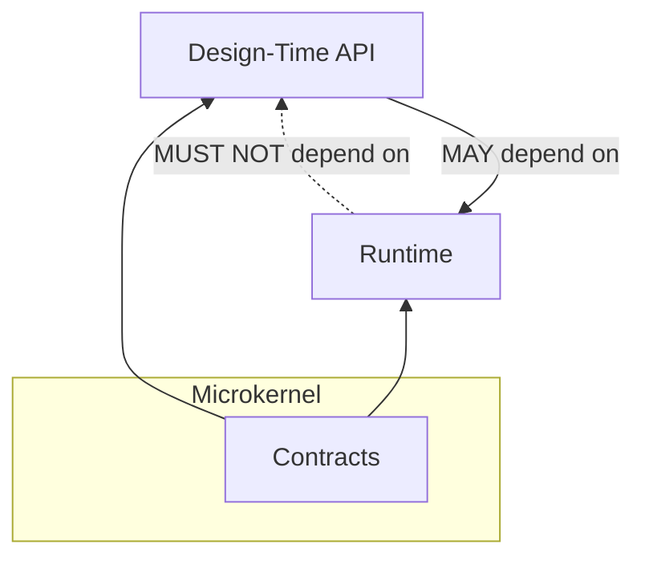
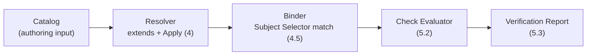
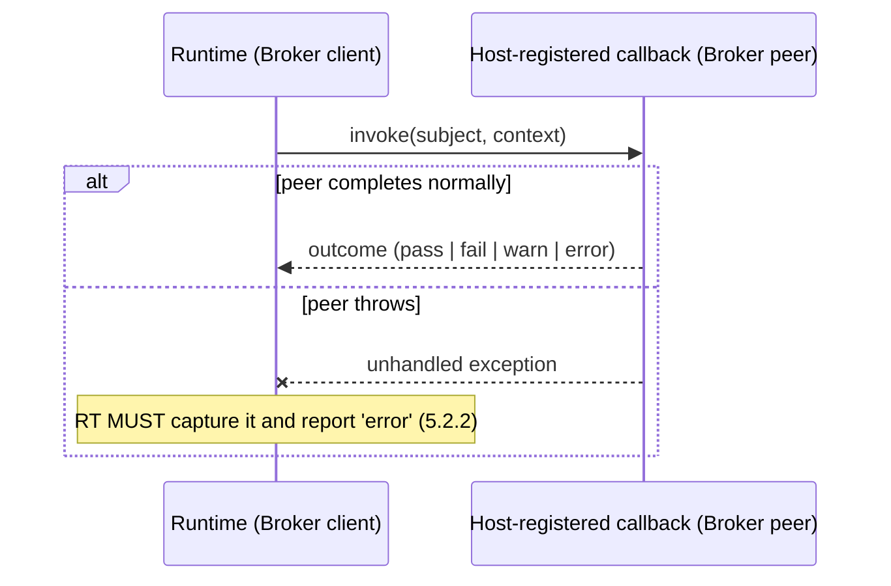

# 10. Design patterns and strategies

This section makes explicit which named architectural patterns — mostly from *Pattern-Oriented
Software Architecture* (POSA, Buschmann et al.) and the GoF catalogue — the shapes already
defined in sections 3–6 realize, and which well-known POSA **problems** (recurring forces that
produce bad designs when ignored) this standard's rules exist to avoid. It restates nothing
normative from earlier sections; it names the pattern each existing MUST/SHOULD already implies,
so an implementer recognizes the shape instead of re-deriving it, per this monorepo's own
[`AGENTS.md`](../../../../AGENTS.md) SOLID/DRY/modular rule.

## 10.1 Why name the patterns explicitly

Two implementers who both satisfy sections 3–9 but describe their own code in unrelated
vocabulary will talk past each other in review, and will independently rediscover (or miss) the
same forces. Naming the pattern pins the vocabulary once, centrally, instead of letting each
binding coin its own.

## 10.2 Pattern catalogue

| Concept in this standard | Pattern | Where | Force resolved |
|---|---|---|---|
| Contracts / Runtime / Design-Time | **Layers** (POSA1) | [section 6](06-architecture.md) | Separates stable shape from verification behavior from authoring tooling; each layer depends only downward. |
| Contracts as the dependency-free core | **Microkernel** (POSA1) | [6](06-architecture.md), [10.7](#107-microkernel-contracts-as-the-kernel) | Runtime, Design-Time, and every Generator-emitted binding are plug-ins around one minimal, stable kernel. |
| Catalog → Resolver → Binder → Evaluator → Report | **Pipes and Filters** (POSA1) | [section 5](05-verification-algorithm.md) | Each stage has a narrow, typed input/output and no shared mutable state, so stages are independently testable and parallelizable (5, "MAY parallelize steps 2–3"). |
| Check `kind` (`expression`/`regex`/`schema`/`external`) | **Strategy** (GoF) | [5.2](05-verification-algorithm.md#52-steps) | New evaluation behavior is added by a new `kind`, never by branching on Requirement Type identity inside the algorithm. |
| `external` Check delegating to a Host-registered callback | **Broker** (POSA1) | [5.2](05-verification-algorithm.md#52-steps) | Decouples the standard's fixed contract (must return an outcome, must not let an exception escape) from the Host's arbitrary peer implementation, across process and language boundaries. |
| `id@version` resolution against the Catalog or a Type/Profile registry | **Registry** | [4.1](04-application-semantics.md#41-reference-resolution) | Centralizes reference lookup so no binding re-implements its own scattered resolution logic. |
| `extends` flattening across Requirement Types/Profiles | **Composite** with cycle guard | [4.2](04-application-semantics.md#42-composition-extends) | Treats a chain or diamond of definitions uniformly as one effective definition; the mandatory cycle rejection (4.2.5) is the textbook defense against the acyclic-structure variant of Composite. |
| Design-Time's typed builders for Instances/Profiles | **Builder** (GoF) | [section 6](06-architecture.md) | Lets an author construct valid data incrementally, with compile-time field-name checking, without exposing the raw schema. |
| PowerShell binding hosting the .NET assemblies | **Facade** over a **Wrapper Facade** (POSA2) | [7.3](07-language-bindings.md#73-powershell) | One native-feeling cmdlet surface in front of a cross-CLR hosting boundary (`Auto` CLR selection), so callers never see the hosting mechanics. |
| Verification Report as the one business-output channel | **Pipeline sink** / explicit output boundary | [5.3](05-verification-algorithm.md#53-verification-report) | Matches this monorepo's QuietCli2 convention that native/engine output is bounded and explicit, never incidental — see [section 12](12-observability-and-profiling.md). |

## 10.3 Layers and the Dependency Rule

Section 6 already states this dependency direction normatively; the diagram exists only to make
the Layers pattern's own well-known failure mode — a lower layer reaching upward ("layer
leakage") — visually checkable against the one rule that forbids it here (Runtime → Design-Time).

## 10.4 Pipes and Filters: the verification pipeline

Each arrow is a typed handoff defined in sections 3–5, not an implementation detail: a binding
MAY fuse adjacent stages for performance (e.g. resolve-and-bind in one pass) as long as the
Verification Report produced is identical to running the stages separately, per the AOT/JIT
equivalence rule in [6.4](06-architecture.md#64-ahead-of-time-vs-just-in-time-resolution).

## 10.5 Strategy: Check kinds

The four Check `kind`s are not an exhaustive enumeration baked into the algorithm; they are
Strategy implementations behind one evaluation contract (5.2.3: always one Verification Result).
[7.6](07-language-bindings.md#76-cross-cutting-requirement) already forbids a binding from adding
a private `kind` silently — new Strategies are proposed as changes to this standard (section 17),
exactly because an unreviewed new Strategy is how the Strategy pattern's own well-known failure
mode (silently incompatible variants) would otherwise appear here.

## 10.6 Broker: `external` Checks and multi-language Generators

The same Broker shape recurs one level up: a [Generator](06-architecture.md#62-the-generator)
is a broker between this standard's language-neutral model (sections 3–5) and each target
language's idiomatic artifact (section 7) — the reason [7.6](07-language-bindings.md#76-cross-cutting-requirement)
can require "the same Verification Report regardless of binding" is that every binding is a peer
behind the same broker contract, never a parallel reimplementation of the model.

## 10.7 Microkernel: Contracts as the kernel

Contracts "depends on nothing from this standard" (6) is the Microkernel pattern's defining
property applied to this model: Runtime, Design-Time, every language's Generator output, and any
future plug-in kind (10.5) are all plug-ins around that one kernel. A kernel that grew a
dependency on any plug-in would stop being a kernel — this is the architectural reason
[6](06-architecture.md)'s dependency direction is a MUST, not a style preference.

## 10.8 Registry: Type/Profile resolution

[4.1](04-application-semantics.md#41-reference-resolution)'s `id@version` resolution and
[8.1](08-configuration.md#81-schema)'s `typeRegistries` are one Registry pattern, not two: a
local Catalog is simply a Registry with no network location, and an external Type/Profile
registry is the same lookup contract over HTTP or another `kind`. A binding MUST implement one
resolution function behind both sources, never a special-cased "local" path that silently skips
the cycle/ambiguity checks required of a "remote" one.

## 10.9 Known POSA problems this standard's rules avoid

| Problem (POSA vocabulary) | How this standard avoids it | Reference |
|---|---|---|
| **Fragmented control** — the same logic re-implemented per Check kind or per language binding | One verification algorithm (section 5), shared by every binding; a binding maps to it, never redefines it | [7.6](07-language-bindings.md#76-cross-cutting-requirement) |
| **God component** — one artifact doing authoring, verification and I/O at once | Three single-responsibility artifacts (Contracts/Runtime/Design-Time) | [6.1](06-architecture.md#61-why-three-artifacts-and-not-one) |
| **Divergent change** — a Catalog format change forcing edits across every binding | Contracts is the one place the shape is defined; bindings map, never redefine | [1.4](01-overview.md#14-design-principles) |
| **Silent drift between layers** — a lower layer quietly depending on a higher one | Explicit, tested dependency direction (10.3) | [6](06-architecture.md), [9.4](09-conformance-and-testing.md#94-checklist) |
| **Unobservable failure** — a run failing with no evidence of why | `unmatched`/`error` outcomes always reported, never silently dropped | [5.4](05-verification-algorithm.md#54-severity-and-thresholds) |
