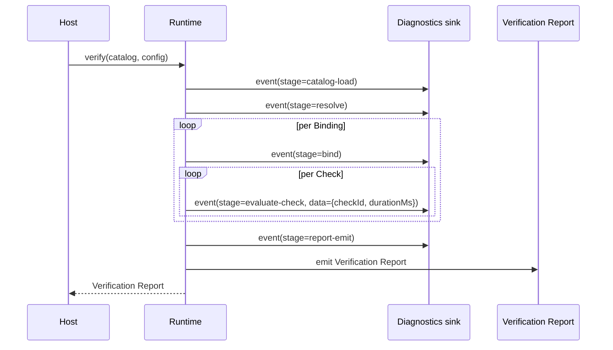

# 12. Observability and profiling

This section defines how a Runtime, Design-Time API, or Generator reports what it is doing
*while it does it*, as distinct from the Verification Report (business output, section 5). It
extends, for this standard specifically, the monorepo's existing rule that native/engine
callbacks "emit no incidental pipeline output" and that metadata/counters are kept separate from
business data (QuietCli2's own convention, [`AGENTS.md`](../../../../AGENTS.md)).

## 12.1 Scope and separation from the Verification Report

A conforming Runtime MUST keep two channels distinct and MUST NOT let one leak into the other:

- The **Verification Report** (5.3): the one business output, produced exactly once per run,
  unaffected by whether diagnostics or profiling are enabled (12.6).
- The **Diagnostics stream**: operational events (this section) — progress, timing, errors in the
  tooling itself — consumed by logs, traces or metrics, never by a Host deciding pass/fail.

## 12.2 Diagnostics event shape

```json
{
  "$id": "urn:frenchexdev:rac:v1:diagnostics-event",
  "$schema": "https://json-schema.org/draft/2020-12/schema",
  "type": "object",
  "required": ["runId", "stage", "timestamp", "level"],
  "properties": {
    "runId": { "type": "string", "description": "Stable id shared by every event of one verification run." },
    "stage": { "enum": ["catalog-load", "resolve", "bind", "evaluate-check", "report-emit"] },
    "timestamp": { "type": "string", "format": "date-time" },
    "level": { "enum": ["trace", "debug", "info", "warn", "error"] },
    "message": { "type": "string" },
    "data": { "type": "object", "description": "Structured, stage-specific detail (e.g. instanceId, checkId, durationMs)." }
  }
}
```

`stage` values match the pipeline stages named in
[10.4](10-design-patterns-and-strategies.md#104-pipes-and-filters-the-verification-pipeline).
A `service`-mode Runtime ([section 11](11-execution-models.md)) MUST also tag each event with the
`runId` returned by `POST /v1/catalogs/{id}/{version}/verify-async`
([11.2](11-execution-models.md#112-verification-service-api)), so a client polling
`GET /v1/runs/{runId}` can correlate diagnostics with that specific run.

## 12.3 Tracing

A run SHOULD be instrumented as a single trace identified by `runId`, with one span per stage
(12.2). When a stage's work is itself a `(Binding, Check)` evaluation
([5.2](05-verification-algorithm.md#52-steps)), the `evaluate-check` span SHOULD be one child
span per Check, not one span for the whole run, so a slow Check is attributable rather than
averaged away.

- An `external` Check's Broker call ([10.6](10-design-patterns-and-strategies.md#106-broker-external-checks-and-multi-language-generators))
  MUST propagate `runId` into the `CheckContext` passed to the Host-registered callback, so a
  Host's own tracing can correlate a slow peer call back to the run that triggered it. This is
  the one piece of diagnostics data this standard requires a binding to thread through the
  Contracts-level `CheckContext` type (6); everything else in this section is additive and
  out-of-band.

## 12.4 Sequence diagram



## 12.5 Metrics

A Runtime SHOULD expose, in whatever shape its ecosystem's idiomatic metrics API uses (this
standard mandates the *content*, not the transport or sink — no specific metrics backend is
required):

- Verification Result counts by `outcome` and `severity` (5.3/5.4).
- Evaluation duration per Check `kind` (5.2) — distribution, not just an average, since a Broker
  (`external`) Check's latency is typically bimodal (cache hit vs. miss).
- Catalog size (Requirement Types, effective Instances, Bindings) and `unmatched` count (4.5), so
  a Host can detect catalog growth or selector drift over time without re-reading every report.

## 12.6 Profiling MUST NOT change outcomes

[Section 8](08-configuration.md)'s `profilingMode` field (`off` | `summary` | `per-binding`, see
8.1) controls how much per-Binding/per-Check timing data a Runtime records. Enabling it:

- MUST produce a Verification Report byte-for-byte identical to running with `profilingMode: off`
  for the same Catalog and configuration — profiling observes the run, it never participates in
  it. This is the same no-side-effect requirement [5.2](05-verification-algorithm.md#52-steps)
  already places on an `expression` Check ("MUST be pure... MUST NOT mutate the Subject"), applied
  to the measuring apparatus itself.
- MUST still respect the evaluation timeout (5.2): recording that a Check is slow is not a
  license to let it run longer than configured.
- SHOULD record, at `per-binding` granularity, enough data to answer "which Binding, which Check,
  how long" without re-running the verification — this is what makes profiling useful for finding
  a slow `external` Check in a large Catalog rather than only confirming that the run as a whole
  was slow.

## 12.7 Relationship to monorepo conventions

This section's two-channel split (12.1) is this standard's instance of the monorepo-wide rule
that native output is "streamed once with bounded buffers" and that a storage layer "stores
metadata and counters, not business output" (QuietCli2, [`AGENTS.md`](../../../../AGENTS.md)): the
Diagnostics stream here plays the role QuietCli2's SQLite metadata store plays there, and the
Verification Report plays the role QuietCli2's bounded business-data result plays there. An
implementation already honoring that monorepo convention satisfies this section by construction.
