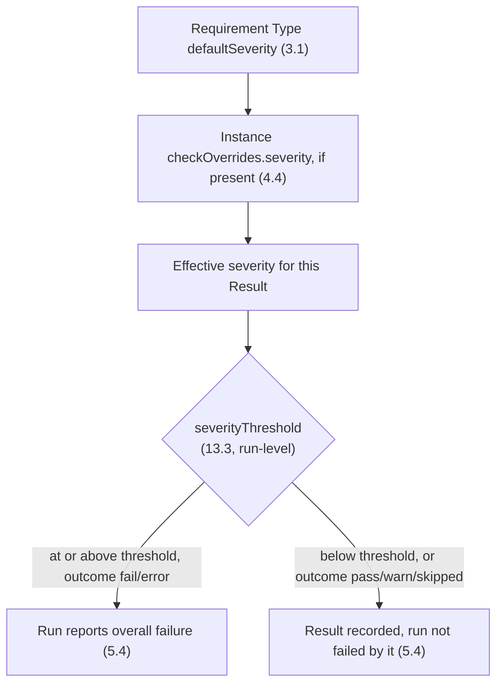

# 13. Configuration precedence and levels

Sections 4 and 8 each define an override mechanism — one over *data*, one over *run posture*.
This section makes the two axes, and the precedence within the second one, explicit and total,
so that "what severity does this Result end up with, and does it fail the run" always has one
deterministic answer traceable to a named level.

## 13.1 Two independent axes

- **Data-level** (sections 3–4): what a Requirement Type/Instance/Profile itself says —
  `defaultSeverity`, `checkOverrides[].severity`, `checkOverrides[].suppressed` — travels with the
  data, is authored by requirement authors, and is identical regardless of which Host runs it.
- **Run-level** (section 8, and this section): how a given Host, on a given run, wants to react —
  `severityThreshold`, `shortCircuit`, `resolutionMode`, `profilingMode` ([12.6](12-observability-and-profiling.md#126-profiling-must-not-change-outcomes))
  — is chosen by whoever operates that Host and MAY differ between a local dev run and a CI run
  of the *same* Catalog.

These axes compose in a fixed order and MUST NOT be conflated: a Host cannot lower a Check's
*effective severity* by changing `severityThreshold` (that only changes which severities fail the
*run*), and a requirement author cannot change the *run's* short-circuit policy from inside a
Requirement Instance.

## 13.2 Data-level resolution (recap)

Already normative in [4.2](04-application-semantics.md#42-composition-extends) and
[4.4](04-application-semantics.md#44-suppression); restated here only to anchor step 1 of 13.4:
`extends` flattening, then Instance-level `checkOverrides`, produce each Result's *effective
severity* before any run-level configuration is consulted.

## 13.3 Run-level precedence, highest to lowest

1. An explicit parameter passed by the Host at the call site (a cmdlet parameter, an API call
   argument, or a `verify`/`verify-async` request body field — [11.2](11-execution-models.md#112-verification-service-api)
   — in `service` execution model) for one run.
2. A process environment variable overriding one scalar field: `RAC_SEVERITY_THRESHOLD`,
   `RAC_SHORT_CIRCUIT`, `RAC_RESOLUTION_MODE`, `RAC_PROFILING_MODE` — each optional, each
   overriding exactly the matching [8.1](08-configuration.md#81-schema) field and nothing else.
   `RAC_CONFIG` ([8.2](08-configuration.md#82-file-and-discovery-convention)) is a different kind
   of variable — it locates the configuration file, it does not override a value inside it — and
   is unaffected by this list.
3. The Host's own native configuration, layered on top of the file per
   [8.2](08-configuration.md#82-file-and-discovery-convention).
4. The configuration file resolved via `RAC_CONFIG` or default discovery
   ([8.1](08-configuration.md#81-schema)/[8.2](08-configuration.md#82-file-and-discovery-convention)).
5. The schema's own stated defaults (8.1), e.g. `severityThreshold: error`,
   `shortCircuit: collect-all`, `resolutionMode: just-in-time`, `profilingMode: off`,
   `executionModel: embedded`.

A binding MUST resolve every scalar field independently at the highest level that sets it
explicitly; a lower level setting a field that a higher level also sets MUST be ignored for that
field, never merged with it.

## 13.4 Full resolution order for one Result

Data-level resolution (13.2) decides what severity a Result *has*. Run-level configuration (13.3)
decides, after that, whether a Result at that severity *fails the run*. Neither step is ever
skipped, and their order is fixed: a run-level threshold change can never retroactively change an
effective severity that section 4 already fixed.

## 13.5 No partial merge of structured fields

`catalogSources` and `typeRegistries` ([8.1](08-configuration.md#81-schema)) are arrays, not
scalars. When more than one level in 13.3 sets one of these fields, the **highest** level that
sets it wins *in full* — its array replaces, it does not concatenate with, any value a lower
level set. An implementation MUST NOT silently union catalog sources from two configuration
layers; a Host that wants both MUST say so explicitly in whichever layer it controls.

## 13.6 Terminology note: "profile" is not reused across axes

The data-level axis has its own **Profile** ([3.3](03-core-model.md#33-profile)): a bundle of
Requirement Types/Instances. The run-level axis has no such bundling primitive in sections 8/13
themselves; where ecosystems want to name and reuse a fixed *configuration* bundle (e.g. "the CI
posture" vs. "the local-dev posture"), [15.5](15-typing-and-deployment-profiles.md#155-deployment-profile)
defines **Deployment Profile** as a distinct term for exactly that, so that the word "profile"
never silently means two different schemas in the same conversation about this standard.

## 13.7 Relationship to execution models

[Section 11](11-execution-models.md)'s `executionModel` field is itself just another scalar
resolved by 13.3, like any other — choosing `service` changes nothing about this section's
precedence order. In `service` mode, step 1 of 13.3 is a request-body field on `POST
.../verify`/`verify-async` ([11.2](11-execution-models.md#112-verification-service-api)) rather
than a cmdlet/API parameter, but it occupies the same, highest, precedence slot.
