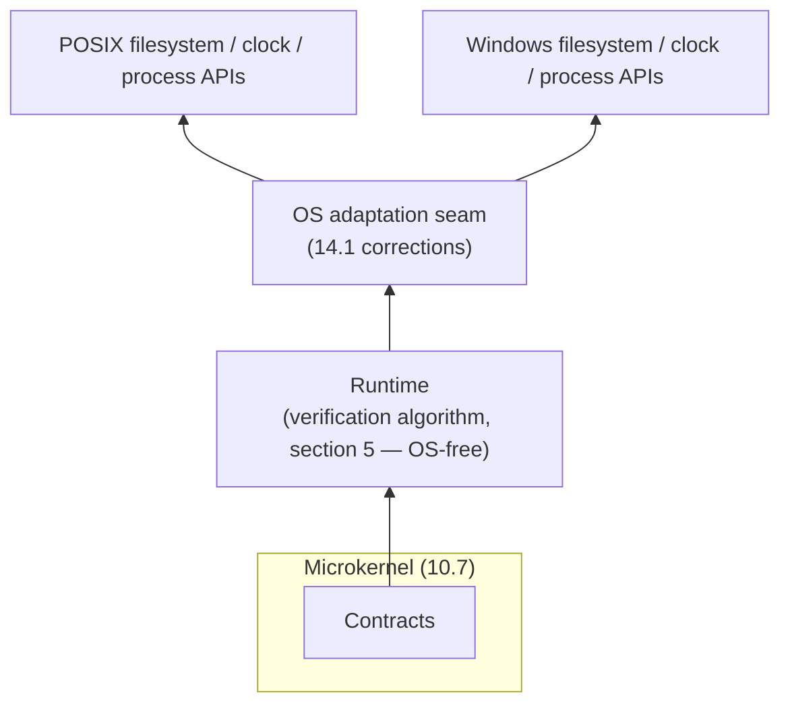

# 14. Interoperability and platform differences

This standard's bindings span a Windows-only PowerShell host, cross-platform .NET, and
cross-platform Rust/C++ ([section 7](07-language-bindings.md)), running on both POSIX systems and
Windows. This section lists the concrete points where those platforms disagree and states, for
each, the correction a conforming binding MUST apply so that the same Catalog produces the same
Verification Report regardless of host OS — the same property
[7.1](07-language-bindings.md#71-conformance-test-vectors) already requires across languages,
extended here across operating systems.

## 14.1 Divergence table

| Divergence point | POSIX | Windows | Required correction |
|---|---|---|---|
| Path separators in a Subject Selector glob ([3.2](03-core-model.md#32-requirement-instance)) | `/` | `/` or `\` | A binding MUST treat `/` as the Catalog's one canonical separator and MUST normalize any `\` it reads from a native Windows path before glob matching; a Catalog's `subjectSelector` MUST NOT contain a literal `\`. |
| Filesystem case sensitivity | Case-sensitive (ext4, most POSIX) | Case-insensitive by default (NTFS) | A binding MUST NOT defer to the OS default; selector matching MUST use an explicit, configured case rule (default case-sensitive) so the same Catalog binds the same Subjects on both. |
| Line endings in a `regex` Check's target text (5.2) | `LF` | `CRLF` common, `LF` increasingly | A binding MUST normalize `CRLF` to `LF` before matching unless the Check explicitly opts into raw-byte matching, consistent with this monorepo's own "UTF-8 and LF line endings" rule ([`AGENTS.md`](../../../../AGENTS.md)) for how Catalog/source files are authored. |
| Environment variable name matching | Case-sensitive | Case-insensitive | `RAC_CONFIG` and the scalar override variables ([13.3](13-configuration-precedence-and-levels.md#133-run-level-precedence-highest-to-lowest)) MUST be read using each OS's native case rule; a binding MUST NOT impose its own divergent case rule on top of the OS's. |
| Process invocation for an `external` Check's native peer (5.2, Broker) | Shell word-splitting | `CommandLineToArgvW` quoting | A binding MUST go through its ecosystem's sanctioned process-invocation facade (this monorepo's `quiet`/QuietCli2 alias for PowerShell hosts, [`AGENTS.md`](../../../../AGENTS.md)) rather than ad hoc shelling out, and MUST quote/escape per the target OS's rules — a quoting bug MUST NOT be allowed to silently change a Check's outcome. |
| Replacing a file still open for reading (Catalog hot-reload, [6.4](06-architecture.md#64-ahead-of-time-vs-just-in-time-resolution) JIT mode) | Allowed (unlink-while-open) | Sharing violation by default | A Runtime watching a Catalog file MUST use a platform-appropriate strategy — atomic rename-into-place on POSIX; `FileShare.Delete`/retry-with-backoff (or an equivalent non-exclusive open) on Windows — and MUST NOT crash or silently stop watching on either platform. |
| Evaluation-timeout clock (5.2) | `CLOCK_MONOTONIC` | `QueryPerformanceCounter` | A binding MUST measure the timeout with a monotonic clock, never wall-clock, so a system clock adjustment never falsely fires or falsely suppresses a timeout. |
| Default text encoding / code page | UTF-8 | Legacy code page common on older hosts | Every Catalog/Configuration file read or write MUST force UTF-8 explicitly; a binding MUST NOT rely on the OS or console default, per the monorepo-wide UTF-8 rule. |
| Verification Report persisted to disk (`report.path`, [8.1](08-configuration.md#81-schema)) | — | — | MUST be written with `LF` line endings regardless of host OS default, per the monorepo's text-encoding rule — the Report is data at that point, but the file carrying it still follows the repository's text convention. |

## 14.2 Normative summary

- A binding MUST NOT let any row in 14.1 change which Bindings (4.5) are produced, which Checks
  pass or fail (5.2), or which severity threshold decision (5.4) results, for the same Catalog —
  platform is never an observable input to the verification algorithm itself.
- Where a correction above requires OS-specific code, that code MUST live behind a single,
  narrow OS-adaptation seam the verification algorithm (section 5) calls through, never as inline
  `if (OperatingSystem.IsWindows())`-style branches scattered across the algorithm — this is the
  same Layers discipline [section 10](10-design-patterns-and-strategies.md#103-layers-and-the-dependency-rule)
  already requires between Contracts/Runtime/Design-Time, applied one layer deeper.

## 14.3 Testing requirement

The property/fuzz test suite mandated by
[section 9](09-conformance-and-testing.md#92-testing-mandate) MUST include, for every binding, at
least one Subject Selector fixture shaped like a POSIX path and one shaped like a Windows path
(including a mixed-separator and a mixed-case variant), so that a platform divergence from 14.1
is caught by the standard's own conformance test vectors
([7.1](07-language-bindings.md#71-conformance-test-vectors)) rather than discovered later in a
production run on whichever OS the author did not develop on.
