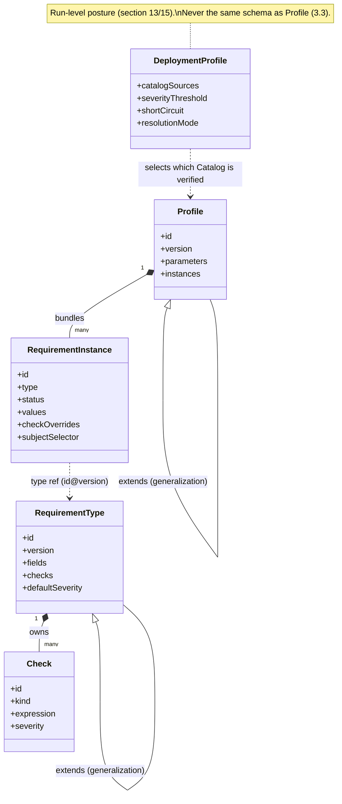

# 15. Type system and Deployment Profiles

This section completes two things [section 6](06-architecture.md) and [section 7](07-language-bindings.md)
only partially specify: the exact mapping from an abstract Field `type` (3.1) to each language's
native type, and a precise term for a *named, reusable configuration posture* — distinct from the
data-level **Profile** already defined in [3.3](03-core-model.md#33-profile) — introduced because
[13.6](13-configuration-precedence-and-levels.md#136-terminology-note-profile-is-not-reused-across-axes)
needs one and this standard's own terminology rules (section 2) do not let a term go undefined.

## 15.1 Cross-language Field type mapping

| Abstract type ([3.1](03-core-model.md#31-requirement-type)) | JSON Schema | C# | Rust | C++ | PowerShell |
|---|---|---|---|---|---|
| `string` | `"type": "string"` | `string` | `String` | `std::string` | `[string]` |
| `integer` | `"type": "integer"` | `long` | `i64` | `std::int64_t` | `[long]` |
| `number` | `"type": "number"` | `double` | `f64` | `double` | `[double]` |
| `boolean` | `"type": "boolean"` | `bool` | `bool` | `bool` | `[bool]` |
| `string[]` | `"type": "array", "items": {"type": "string"}` | `List<string>` (`IReadOnlyList<string>` on Design-Time read models) | `Vec<String>` | `std::vector<std::string>` | `[string[]]` |
| `object` | `"type": "object"` | `System.Text.Json.JsonElement` (or an equivalent structured document type) | `serde_json::Value` | an opaque JSON value (`nlohmann::json` or the toolchain's chosen library) | `[hashtable]` / `[PSCustomObject]` |

A Generator ([6.2](06-architecture.md#62-the-generator)) MUST use exactly this mapping when
emitting a Design-Time type for a Field; this is the complete table that
[6.2](06-architecture.md#62-the-generator)'s single `string[]` example previews.

## 15.2 Optionality and nullability

A Field with `required: false` and no `default` ([3.1](03-core-model.md#31-requirement-type))
MUST map to that language's idiomatic "absent" representation, never to a sentinel value of the
same type (an empty string is not the same as an absent one):

| Language | "Absent" representation |
|---|---|
| C# | `Nullable<T>` for value types; a plain reference for reference types, `null`-checked |
| Rust | `Option<T>` |
| C++ | `std::optional<T>` |
| PowerShell | `$null`-permitted parameter/property |

## 15.3 Object fields are opaque, round-trip-only

A Field of type `object` ([3.1](03-core-model.md#31-requirement-type)) carries structured data
this standard does not constrain further. A binding exposes it as that language's idiomatic
dynamic/structured-document type (15.1's last row); this standard mandates only that the value
MUST round-trip losslessly through load → resolve → evaluate → report
([section 4](04-application-semantics.md), [section 5](05-verification-algorithm.md)) — it does
not mandate a specific JSON library, and a binding MAY change library without that being a
breaking change to this standard, since the contract is the round-trip property, not the library.

## 15.4 Why type mapping is normative and not left to each Generator

Without a fixed table, two Generators for the same language could emit incompatible Design-Time
surfaces for the same Requirement Type, which would make "generate a Design-Time API" (1.2.3) a
Generator-specific outcome instead of a standard one — exactly the Divergent Change problem
[10.9](10-design-patterns-and-strategies.md#109-known-posa-problems-this-standard-s-rules-avoid)
already names.

## 15.5 Deployment Profile

**Deployment Profile**: a named, published Configuration document
([8.1](08-configuration.md#81-schema) shape), checked into a project under a stable name — e.g.
`profiles/ci.config.yaml`, `profiles/dev.config.yaml`, `profiles/security-critical.config.yaml`
— so that a *run-level configuration posture* ([section 13](13-configuration-precedence-and-levels.md))
can be named, versioned and reused the same way a data-level
[**Profile**](03-core-model.md#33-profile) names and reuses a bundle of Requirement Instances.

A Deployment Profile:

- Is an ordinary Configuration document; it introduces no new schema field. "Selecting" one is
  simply pointing `RAC_CONFIG` ([8.2](08-configuration.md#82-file-and-discovery-convention)) or a
  Host's native configuration loader at that file.
- MUST NOT be confused with a data-level Profile (3.3): a Deployment Profile fixes
  `severityThreshold`/`shortCircuit`/`resolutionMode`/`profilingMode` and catalog sources for a
  *run*; a data-level Profile fixes Requirement Instances for a *Catalog*. The two are
  independent and compose freely — the same Catalog MAY be verified under the `ci` Deployment
  Profile today and the `dev` one tomorrow, with no change to the Catalog itself.
- SHOULD be named after the posture it represents (`ci`, `dev`, `security-critical`), not after
  the team or date that created it, so its intent survives reorganization.

### Example

```yaml
# profiles/security-critical.config.yaml — a Deployment Profile
catalogSources:
  - kind: file
    location: "./requirements/catalog.yaml"
resolutionMode: ahead-of-time
severityThreshold: warning
shortCircuit: fail-fast
profilingMode: summary
```

## 15.6 Diagram: data model vocabulary, UML-flavored



This diagram uses UML generalization (`<|--`) and composition (`*--`) notation deliberately —
see [section 16](16-relationship-to-existing-standards.md) for why this standard borrows UML's
notation without depending on UML tooling or defining a UML Profile.
